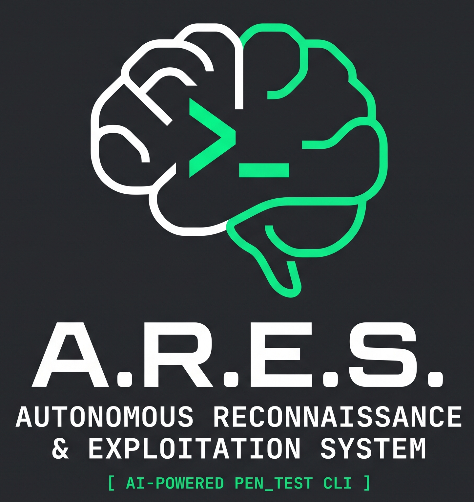

<p align="center">
  
</p>

<p align="center">
  <a href="https://github.com/Antim8er/ARES/stargazers"></a>
  <a href="https://github.com/Antim8er/ARES/blob/main/LICENSE"></a>
  <a href="https://www.python.org/downloads/"></a>
  <a href="https://www.kali.org/"></a>
  <a href="https://github.com/Antim8er/ARES/actions"></a>
</p>

<h1 align="center">A.R.E.S. CLI 🧠</h1>
<h3 align="center">Autonomous Reconnaissance & Exploitation System</h3>

<p align="center">
  <b>100% Local, Privacy-First AI Penetration Testing Agent</b><br>
  <i>Dynamically plans audit workflows, auto-installs missing pentest tools, and executes technical security assessments without cloud data leakage.</i>
</p>

---

> [!WARNING]
> **LEGAL & ETHICAL DISCLAIMER:** A.R.E.S. is designed exclusively for authorized penetration testing, security auditing, and educational security research (e.g., CTF competitions, HackTheBox, TryHackMe). The creators assume no responsibility or liability for unauthorized actions. You must have explicit, written authorization before auditing any target.

---

## ⚡ Why A.R.E.S.?

Commercial cloud AI models (ChatGPT, Claude) often censor legitimate penetration testing requests and log sensitive internal hostnames and IP scans to cloud servers. 

**A.R.E.S. solves this:**
- 🛡️ **Zero Cloud Leaks:** Runs completely on your machine using local LLMs (LM Studio, Ollama, vLLM). No target data or scan outputs leave your perimeter.
- 🧠 **Autonomous Dynamic Planning:** Analyzes scan findings, detects possible CVE vectors, and formulates step-by-step technical plans.
- 🛠️ **Proactive Tool Installation:** Automatically detects if tools (e.g. `nmap`, `sqlmap`, `gobuster`) are missing and prompts to install them via your native package manager (`winget`, `apt`, `brew`).
- 🎮 **Safe-by-Default Simulation:** Dry-run simulation mode is active by default. Every single live execution step requires explicit user approval.
- 🐳 **Isolated Kali Container:** Run inside a sandboxed Kali Linux Docker container with pre-installed security tools.

---

## 🎬 Terminal Preview

```text
  ###                      
    ###                     A . R . E . S .
      ###                   AUTONOMOUS RECONNAISSANCE
        ###    #########    & EXPLOITATION SYSTEM
      ###                   
    ###                     [ AI-POWERED PEN_TEST CLI ]
  ###                      

[+] Detected OS: Linux / Kali
[+] Active Endpoint: http://localhost:1234/v1 (LM Studio)
[+] Model: cognitivecomputations/dolphin3-cyber-8b

Ares > Scan scanme.nmap.org for open services and audit web surface

┌─ Ares • dolphin3-cyber-8b ────────────────────────────────────────────────────────┐
│ Analysis: Target specified (scanme.nmap.org). Commencing reconnaissance phase.     │
│ Plan: Perform TCP service and version scanning with aggressive timing (-sV -T4).   │
│ Tool Required: nmap                                                                │
└────────────────────────────────────────────────────────────────────────────────────┘

Step 1: nmap -sV -T4 scanme.nmap.org
Execute step 1 now? [y/N]: y

[+] Executing step 1...
PORT    STATE SERVICE VERSION
22/tcp  open  ssh     OpenSSH 6.6.1p1 Ubuntu
80/tcp  open  http    Apache httpd 2.4.7

AI considers objective complete → generating Markdown pentest report.
```

> **Tip:** You can generate an animated GIF demo using [Charm VHS](https://github.com/charmbracelet/vhs) anytime by running:
> ```bash
> vhs assets/demo.tape
> ```

---

## 🚀 Quickstart

### Option A: Local Python Setup (Recommended)

1. **Clone the repository:**
   ```bash
   git clone https://github.com/Antim8er/ARES.git
   cd ARES
   ```

2. **Install in editable mode:**
   ```bash
   pip install -e .
   ```

3. **Configure environment:**
   ```bash
   cp .env.example .env
   ```

---

### Option B: Docker / Kali Linux Sandbox 🐳

Run A.R.E.S. in an isolated Kali Linux environment with `nmap`, `sqlmap`, `nikto`, and `gobuster` pre-installed:

```bash
# Build and run with host network (for local target auditing)
docker compose run --rm ares "Audit scanme.nmap.org"
```

---

## 🤖 Connecting Your LLM Engine

A.R.E.S. connects to any OpenAI-compatible endpoint.

### 1. LM Studio (Default)
1. Download and launch [LM Studio](https://lmstudio.ai/).
2. Load an uncensored or technical cyber model:
   - **Recommended:** `cognitivecomputations/dolphin3-cyber-8b`
   - **Alternative (16GB+ RAM):** `bartowski/Qwen2.5-14B_Uncensored_Instruct-GGUF`
3. Start the Local Server in LM Studio (default: `http://localhost:1234/v1`).
4. In `.env`:
   ```env
   LMSTUDIO_BASE_URL="http://localhost:1234/v1"
   ARES_DEFAULT_MODEL="local-model"
   ```

### 2. Ollama
1. Install [Ollama](https://ollama.com/) and pull a coding model:
   ```bash
   ollama pull qwen2.5:14b
   ```
2. Run A.R.E.S. with the `--url` flag or configure `.env`:
   ```bash
   ares-cli "Scan 127.0.0.1" --url http://localhost:11434/v1 -m qwen2.5:14b
   ```

### 3. OpenAI / Cloud API / Custom Proxy
```bash
ares-cli "Analyze target" --url https://api.openai.com/v1 -m gpt-4o-mini --api-key sk-...
```

---

## 💻 Usage & CLI Reference

Start an audit session by describing your objective:

```bash
ares-cli "Scan scanme.nmap.org for open services and web vulnerabilities"
```

Or launch interactive mode directly:
```bash
ares-cli
```

### CLI Flags

| Flag | Shorthand | Description | Default |
|---|---|---|---|
| `--model` | `-m` | Specify the model name | `local-model` |
| `--simulate` / `--no-simulate` | | Dry-run simulation mode (safe) | `True` |
| `--real` | | Enable live command execution | `False` |
| `--target` | `-t` | Explicit target host or IP (e.g. `10.10.10.5`) | `None` |
| `--url` | `-u` | LLM API endpoint URL | `http://localhost:1234/v1` |
| `--api-key` | `-k` | API key for authenticated endpoints | `None` |
| `--auto-confirm` | | Auto-confirm execution steps *(Caution)* | `False` |

---

## 🧪 Testing & Verification

Run the test suite to verify CLI and client integrations:

```bash
pip install pytest
pytest
```

---

## 🤝 Contributing

Contributions from penetration testers, red teamers, and AI developers are warmly welcomed! Please read [CONTRIBUTING.md](CONTRIBUTING.md) and [SECURITY.md](SECURITY.md) before submitting pull requests.

---

## 📜 License

This project is licensed under the [MIT License](LICENSE).
